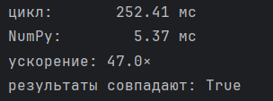

# Максимально простой скрипт для сравнения «циклы vs NumPy»

## 1 Задача

```
import time
import numpy as np

rng = np.random.default_rng(42)
a = rng.normal(size=1_000_000)


def loop_sum(arr):
    total = 0.0
    for x in arr:
        total += x
    return total


def numpy_sum(arr):
    return arr.sum()


def measure(fn, x, repeat=3):
    best = float("inf")
    result = None
    for _ in range(repeat):
        t0 = time.perf_counter()
        result = fn(x)
        t1 = time.perf_counter()
        best = min(best, t1 - t0)
    return result, best


r_loop,  t_loop  = measure(loop_sum,  a)
r_numpy, t_numpy = measure(numpy_sum, a)

print(f"цикл:   {t_loop*1000:10.2f} мс")
print(f"NumPy:  {t_numpy*1000:10.2f} мс")
print(f"ускорение: {t_loop / t_numpy:.1f}×")
print(f"результаты совпадают: {np.allclose(r_loop, r_numpy)}")
```


## 2 Задача

```
import time
import numpy as np

rng = np.random.default_rng(42)
a = rng.normal(size=1_000_000)


def loop_sum_rows(arr):
    n = len(arr)

    total = 0.0
    for x in arr:
        total += x
    mean_val = total / n

    variance_sum = 0.0
    for x in arr:
        variance_sum += (x - mean_val) ** 2

    std_val = (variance_sum / n) ** 0.5

    return mean_val, std_val


def numpy_sum_rows(arr):
    return arr.mean(), arr.std()


def measure(fn, x, repeat=3):
    best = float("inf")
    result = None
    for _ in range(repeat):
        t0 = time.perf_counter()
        result = fn(x)
        t1 = time.perf_counter()
        best = min(best, t1 - t0)
    return result, best


r_loop, t_loop = measure(loop_sum_rows, a)
r_numpy, t_numpy = measure(numpy_sum_rows, a)

print(f"цикл:   {t_loop * 1000:10.2f} мс")
print(f"NumPy:  {t_numpy * 1000:10.2f} мс")
print(f"ускорение: {t_loop / t_numpy:.1f}×")
print(f"результаты совпадают: {np.allclose(r_loop[0], r_numpy[0])}")
```





