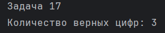
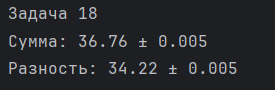
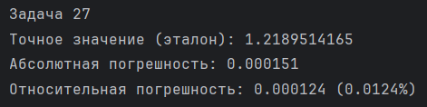

# Домашка 3 задачи

## Я решил сразу всё в один код. Скрины ниже.

```
import math
from decimal import Decimal

a_17 = 81.359
delta_17 = 0.04
digits_17 = [8, 1, 3, 5, 9]
places_17 = [10, 1, 0.1, 0.01, 0.001]
valid_count_17 = 0
for place in places_17:
    if delta_17 <= 0.5 * place:
        valid_count_17 += 1

print("Задача 17")
print(f"Количество верных цифр: {valid_count_17}")

x_18 = Decimal("35.49")
dx_18 = Decimal("0.002")
y_18 = Decimal("1.27")
dy_18 = Decimal("0.003")

sum_val_18 = x_18 + y_18
diff_val_18 = x_18 - y_18
total_delta_18 = dx_18 + dy_18

print("\nЗадача 18")
print(f"Сумма: {sum_val_18} ± {total_delta_18}")
print(f"Разность: {diff_val_18} ± {total_delta_18}")

approx_27 = 1.2188
exact_27 = (2.0 / 3.0) * (2.0 ** 1.5 - 1.0 ** 1.5)

abs_err_27 = abs(approx_27 - exact_27)
rel_err_27 = abs_err_27 / abs(exact_27)

print("\nЗадача 27")
print(f"Точное значение (эталон): {exact_27:.10f}")
print(f"Абсолютная погрешность: {abs_err_27:.6f}")
print(f"Относительная погрешность: {rel_err_27:.6f} ({rel_err_27 * 100:.4f}%)")
```

## Задача 1


## Задача 2


## Задача 3
