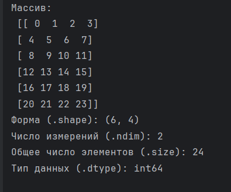
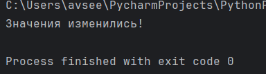
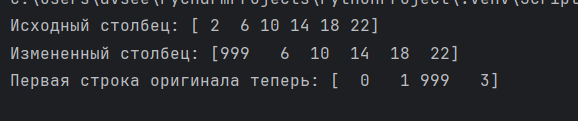
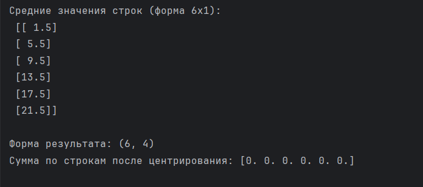

# Мини-упражнения

## 1
```
import numpy as np

arr = np.arange(24).reshape(6, 4)

print("Массив:\n", arr)
print("Форма (.shape):", arr.shape)
print("Число измерений (.ndim):", arr.ndim)
print("Общее число элементов (.size):", arr.size)
print("Тип данных (.dtype):", arr.dtype)
```



## 2

```
import numpy as np

arr = np.arange(24).reshape(6, 4)
arr_4x6 = arr.reshape(4, 6)
arr_3d = arr.reshape(2, 3, 4)
arr_flat = arr.reshape(24)

print("Значения изменились!")
```



## 3

```
import numpy as np

arr = np.arange(24).reshape(6, 4)
col_view = arr[:, 2]
print("Исходный столбец:", col_view)

col_view[0] = 999

print("Измененный столбец:", col_view)
print("Первая строка оригинала теперь:", arr[0])
```



## 4

```

```


## 5

```
import numpy as np

arr = np.arange(24).reshape(6, 4)
row_means = arr.mean(axis=1, keepdims=True)
print("Средние значения строк (форма 6x1):\n", row_means)
centered_arr = arr - row_means
print("\nФорма результата:", centered_arr.shape)
print("Сумма по строкам после центрирования:", centered_arr.sum(axis=1))
```

